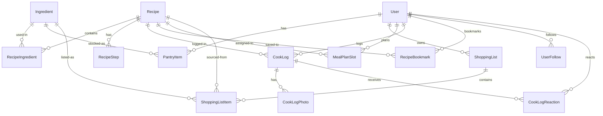

# BuzzKitchen — Data Model

## schema.prisma

```prisma
generator client {
  provider = "prisma-client-js"
}

datasource db {
  provider = "postgresql"
  url      = env("DATABASE_URL")
}

model User {
  id             String    @id @default(uuid())
  email          String    @unique
  display_name   String
  avatar_url     String?
  google_sub     String?   @unique
  apple_sub      String?   @unique
  push_token     String?
  cooking_streak Int       @default(0)
  last_cooked_at DateTime?
  premium_until  DateTime?
  created_at     DateTime  @default(now())
  updated_at     DateTime  @updatedAt

  pantry_items    PantryItem[]
  shopping_lists  ShoppingList[]
  meal_plan_slots MealPlanSlot[]
  cook_logs       CookLog[]
  bookmarks       RecipeBookmark[]
  following       UserFollow[]     @relation("Follower")
  followers       UserFollow[]     @relation("Following")
  reactions       CookLogReaction[]

  @@index([email])
}

model Recipe {
  id               String   @id @default(uuid())
  title            String
  description      String?
  thumbnail_url    String?
  youtube_video_id String?
  cook_time_min    Int
  prep_time_min    Int      @default(0)
  servings         Int      @default(2)
  difficulty       String   @default("medium")
  is_vegetarian    Boolean  @default(false)
  is_premium       Boolean  @default(false)
  is_featured      Boolean  @default(false)
  tags             String[]
  created_at       DateTime @default(now())
  updated_at       DateTime @updatedAt

  ingredients     RecipeIngredient[]
  steps           RecipeStep[]
  cook_logs       CookLog[]
  bookmarks       RecipeBookmark[]
  meal_plan_slots MealPlanSlot[]
  shopping_items  ShoppingListItem[]

  @@index([cook_time_min])
  @@index([is_vegetarian])
  @@index([is_featured])
  @@index([created_at])
}

model Ingredient {
  id             String   @id @default(uuid())
  name           String   @unique
  name_en        String?
  aisle_category String   @default("その他")
  created_at     DateTime @default(now())

  recipe_ingredients RecipeIngredient[]
  pantry_items       PantryItem[]
  shopping_items     ShoppingListItem[]

  @@index([name])
}

model RecipeIngredient {
  id            String  @id @default(uuid())
  recipe_id     String
  ingredient_id String
  quantity      Float?
  unit          String?
  is_optional   Boolean @default(false)
  display_order Int     @default(0)

  recipe     Recipe     @relation(fields: [recipe_id], references: [id], onDelete: Cascade)
  ingredient Ingredient @relation(fields: [ingredient_id], references: [id])

  @@unique([recipe_id, ingredient_id])
  @@index([recipe_id])
}

model RecipeStep {
  id                    String  @id @default(uuid())
  recipe_id             String
  step_order            Int
  text                  String
  youtube_timestamp_sec Int?

  recipe Recipe @relation(fields: [recipe_id], references: [id], onDelete: Cascade)

  @@unique([recipe_id, step_order])
  @@index([recipe_id])
}

model PantryItem {
  id            String   @id @default(uuid())
  user_id       String
  ingredient_id String
  quantity      Float?
  unit          String?
  added_at      DateTime @default(now())

  user       User       @relation(fields: [user_id], references: [id], onDelete: Cascade)
  ingredient Ingredient @relation(fields: [ingredient_id], references: [id])

  @@unique([user_id, ingredient_id])
  @@index([user_id])
}

model ShoppingList {
  id         String   @id @default(uuid())
  user_id    String
  title      String   @default("買い物リスト")
  created_at DateTime @default(now())
  updated_at DateTime @updatedAt

  user  User               @relation(fields: [user_id], references: [id], onDelete: Cascade)
  items ShoppingListItem[]

  @@index([user_id])
}

model ShoppingListItem {
  id              String   @id @default(uuid())
  list_id         String
  ingredient_id   String?
  ingredient_name String
  recipe_id       String?
  quantity        Float?
  unit            String?
  aisle_category  String   @default("その他")
  checked         Boolean  @default(false)
  added_manually  Boolean  @default(false)
  created_at      DateTime @default(now())

  list       ShoppingList @relation(fields: [list_id], references: [id], onDelete: Cascade)
  ingredient Ingredient?  @relation(fields: [ingredient_id], references: [id])
  recipe     Recipe?      @relation(fields: [recipe_id], references: [id], onDelete: SetNull)

  @@index([list_id])
  @@index([ingredient_id])
}

model MealPlanSlot {
  id        String   @id @default(uuid())
  user_id   String
  date      DateTime
  slot_type String
  recipe_id String

  user   User   @relation(fields: [user_id], references: [id], onDelete: Cascade)
  recipe Recipe @relation(fields: [recipe_id], references: [id])

  @@unique([user_id, date, slot_type])
  @@index([user_id, date])
}

model CookLog {
  id        String   @id @default(uuid())
  user_id   String
  recipe_id String
  rating    Int
  note      String?  @db.VarChar(140)
  cooked_at DateTime @default(now())

  user      User              @relation(fields: [user_id], references: [id], onDelete: Cascade)
  recipe    Recipe            @relation(fields: [recipe_id], references: [id])
  photos    CookLogPhoto[]
  reactions CookLogReaction[]

  @@index([user_id])
  @@index([recipe_id])
  @@index([cooked_at])
}

model CookLogPhoto {
  id         String   @id @default(uuid())
  log_id     String
  url        String
  blob_path  String
  created_at DateTime @default(now())

  log CookLog @relation(fields: [log_id], references: [id], onDelete: Cascade)

  @@index([log_id])
}

model CookLogReaction {
  id      String @id @default(uuid())
  log_id  String
  user_id String
  emoji   String

  log  CookLog @relation(fields: [log_id], references: [id], onDelete: Cascade)
  user User    @relation(fields: [user_id], references: [id], onDelete: Cascade)

  @@unique([log_id, user_id])
  @@index([log_id])
}

model UserFollow {
  id           String   @id @default(uuid())
  follower_id  String
  following_id String
  created_at   DateTime @default(now())

  follower  User @relation("Follower", fields: [follower_id], references: [id], onDelete: Cascade)
  following User @relation("Following", fields: [following_id], references: [id], onDelete: Cascade)

  @@unique([follower_id, following_id])
  @@index([follower_id])
  @@index([following_id])
}

model RecipeBookmark {
  id            String   @id @default(uuid())
  user_id       String
  recipe_id     String
  bookmarked_at DateTime @default(now())

  user   User   @relation(fields: [user_id], references: [id], onDelete: Cascade)
  recipe Recipe @relation(fields: [recipe_id], references: [id], onDelete: Cascade)

  @@unique([user_id, recipe_id])
  @@index([user_id])
}
```

## ER Diagram


